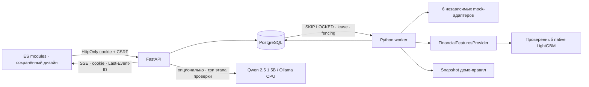
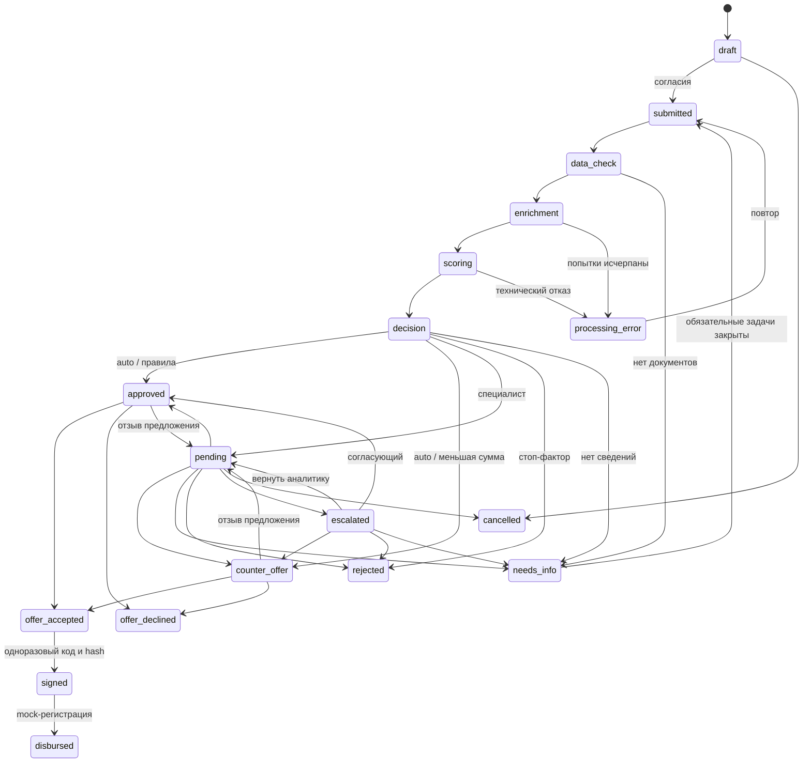
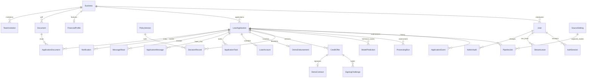

# Архитектура, состояния и ERD

API принимает submit без долгой обработки. Job хранит submission, stage, attempts, run_after, lease_token/until и snapshot правил/источников. Worker фиксирует snapshot, завершает транзакцию, вызывает адаптер/ML, затем повторно проверяет fencing token и сохраняет результат. Истёкший RUNNING lease подхватывается; максимальное число попыток ограничено. API и worker используют один runtime-образ; отдельный heartbeat проверяется внутри worker-контейнера. Redis/Celery не требуются.

Разрешённые переходы и дополнительные cancel-ветви проверяются в `services/pipeline.py`. Повторные accept/sign/disburse возвращают существующий результат. Истечение предложения проверяется сервером, не меняет задним числом условия; worker создаёт уведомления об истечении. Старые `processing`/`completed` сохранены для совместимости, completed без выдачи не создаёт LoanAccount.

Связь SourceSetting→job на схеме логическая: режимы снимаются в snapshot/историю, FK нет. WorkerHeartbeat и SystemSetting — служебные записи. Договор, график и terms сохраняются неизменно; суммы графика — Decimal с округлением HALF_UP до копеек, JSON хранит десятичные строки.

Все модели регистрируются общей metadata. Миграции main не изменены; новые ревизии a2026c002001/002002 добавляют таблицы/роли/поля. PostgreSQL upgrade проверяет сохранность старой учётной записи, сессии и черновика. Данные чужих организаций скрываются 404, права операции — 403, конфликт версии/статуса — 409.
