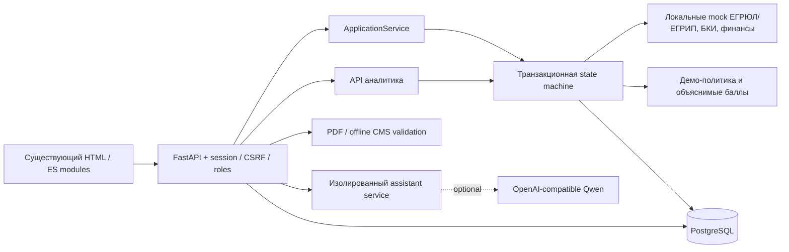
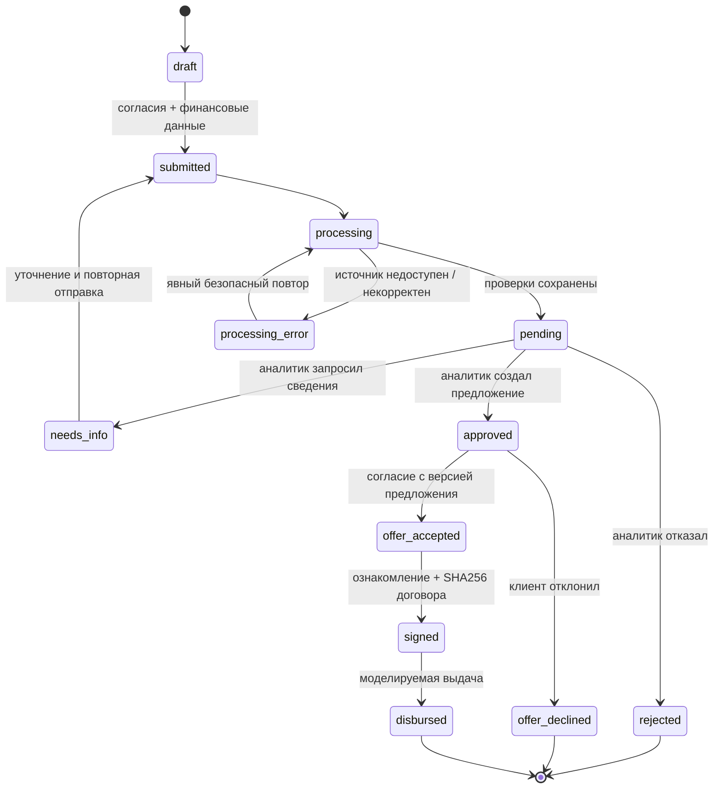

# Архитектура интегрированного кабинета

`submitted` и `processing` записываются в историю, локальная обработка заканчивается в
той же транзакции. Падение процесса до commit откатывает весь незавершённый переход.
Старые статусы сохранены, включая `completed` без заявления о реальной или новой демо-выдаче.

## Модель данных

| Таблица | Связи и назначение |
| --- | --- |
| businesses / users | Организация, тип, ИНН; пользователь и существующая роль |
| auth_sessions / auth_rate_limits | Хешированные токены и серверные лимиты |
| loan_applications | FK организации/автора, финансы, статус, версия, сценарий mock |
| application_events | FK заявки/инициатора; уникальны заявка + версия события |
| documents | PDF bytes, SHA256, тип, результаты подписи, FK организации, исходной заявки |
| application_documents | Многие-ко-многим: повторное использование PDF организации |
| processing_runs | Неизменяемые снимки источников, demo risk, рекомендации; версия заявки |
| scoring_results | Независимая история ML банкротства, версия и хеш артефакта |
| credit_offers | Версия условий, сумма/срок/ставка/платёж, текст и SHA256 договора, согласие |
| demo_contracts | Один offer_id, пользователь, ознакомление, время условной подписи |
| demo_disbursements | Уникальны заявка и offer_id; сумма и время моделируемой выдачи |
| assistant_conversations / assistant_turns | История по user_id, request_id, lease/revision |

Владение проверяется по business_id из существующей сессии. Клиентский ownerId не доверенный.
Документы черновиков скрыты от аналитика; после отправки доступны для рассмотрения.
Переходы используют SELECT FOR UPDATE, затем UPDATE с проверкой версии и статуса.
Уникальные ключи договора и выдачи служат дополнительной защитой. UI хранит подтверждённые
данные только в памяти и восстанавливает их через API; legacy browser adapter оставлен для
совместимости старых модульных тестов и не активируется в приложении.

## Ограничения

Правила и все источники синтетические. Заданные пользователем показатели — анкета,
а не подтверждённая финансовая отчётность. ML банкротства отдельно от кредитной политики.
Проверка подписи offline не подтверждает подлинность ФНС и отзыв сертификата.
Рабочая очередь не нужна: все обязательные адаптеры локальные, обработка ограничена одной
транзакцией. Для реальных долгих источников потребуется отдельная очередь и recovery worker.
